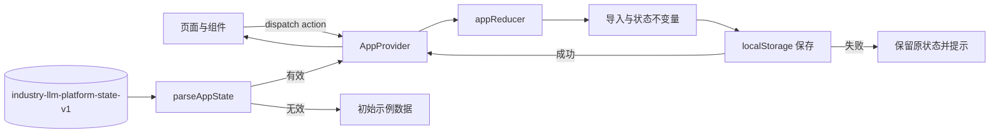

# 设计说明

## 设计目标

本项目根据参考视频重建一个行业大模型管理平台。视频主要展示数据集管理，因此该页面以高保真布局为基准；知识库、切片、智能体和问答流程根据侧栏信息和业务逻辑进行了合理扩展。

设计优先级依次为：

1. 业务操作可完成、状态可验证。
2. 页面层级与参考视频保持一致的视觉印象。
3. 在桌面、短屏和窄屏下保持可操作性。
4. 错误、空数据和存储失败必须明确可见。

## 视觉方向

整体采用低饱和紫色企业后台视觉：

- 顶部使用蓝紫到紫红色渐变，形成跨页面的统一品牌带。
- 侧栏使用白底与轻量分组，选中项使用淡紫背景和左侧强调线。
- 内容区使用浅灰画布、白色面板、细边框和低对比阴影。
- 数据表格保持较高信息密度，避免所有区域都被做成大卡片。
- 问答工作区使用浅蓝紫渐变和低对比同心纹理，与后台管理区形成场景区分。

设计不通过堆叠装饰来表达“AI 感”，主要依靠知识引用、对话层级和操作反馈体现智能业务属性。

## 信息架构

```text
行业大模型管理平台
├── 数据管理
│   └── 数据集管理
│       ├── 分类与筛选
│       ├── 上传与启停
│       └── 预览与下载
├── 知识库管理
│   ├── 知识库列表
│   ├── 导入知识
│   ├── 文档列表
│   └── 知识切片
├── 智能体中心
│   ├── 智能体广场
│   └── 智能问答
├── 配置中心
└── 问答记录
```

## 核心用户流程

### 数据进入知识库

```text
上传文本数据集
  → 数据集解析完成
  → 选择目标知识库
  → 选择已启用数据集
  → 生成文档与切片
  → 知识库统计更新
  → 切片可检索
```

### 问答与溯源

```text
选择智能体
  → 输入问题
  → 检索已启用切片
  → 生成带证据的回答
  → 展示引用列表
  → 打开引用
  → 原文精确匹配时高亮
  → 不匹配时显示切片预览提示
```

### 历史会话恢复

```text
问答记录
  → 查看会话
  → 继续问答
  → 恢复消息与引用
  → 追加新问题
```

## 页面设计

### 数据集管理

- 左侧分类树负责范围缩小，右侧筛选条负责精确过滤。
- 工具栏保持“新建数据集”主操作与总量信息左右对照。
- 表格列顺序遵循认知路径：对象 → 分类/来源/格式 → 状态 → 时间 → 操作。
- 桌面低高度视口采用紧凑列表模式，隐藏重复页面标题、缩小控件和行高，优先保证十条数据与分页进入首屏。
- 窄屏隐藏分类树，筛选区改为两列，表格允许横向滚动。

### 知识库与切片

- 知识库列表以数量、更新时间和启停状态为核心。
- 导入页分为“知识库信息”和“数据选择”两段，减少一次页面内需要理解的信息量。
- 切片采用宽文本列；编辑在弹窗中完成，避免误触表格内容。
- 编辑切片会重新生成关键词，并影响后续本地检索。

### 智能体广场

- 顶部标签区分“全部”与“最近使用”。
- 智能体筛选同时支持类型、业务场景和名称搜索。
- 卡片使用业务色顶部边框和识别图形区分不同智能体。
- “详情”用于补充上下文，“体验”是主要操作。

### 问答工作区

- 桌面采用会话栏、消息区、引用栏三栏结构。
- 无会话时显示欢迎信息和建议问题，降低首次使用门槛。
- 回答按标题、正文和来源分层；引用按钮进入独立引用面板。
- 720px 以下引用栏覆盖在工作区右侧，560px 以下会话栏改为可展开面板。
- 输入区优先保留发送按钮和模型、知识库选择。

## 状态与数据架构



核心状态包括数据集、知识库、文档、切片、智能体、会话和问答设置。页面通过统一上下文读取和更新状态，减少跨页面分叉。

## 检索与引用设计

- 只检索当前启用知识库中的启用文档与启用切片。
- 排序同时考虑标题、正文、关键词和中文二字符重合度。
- 回答正文直接引用命中的切片，不编造未检索到的证据。
- 每条回答保存引用快照，历史回答不会因切片后续编辑而改变。
- 原文预览会再次检查当前源文档是否包含该切片；不能精确匹配时明确降级为“切片预览”。

## 设计令牌

| 令牌 | 值 | 用途 |
| --- | --- | --- |
| `--accent` | `#6355e7` | 主操作、选中态、强调线 |
| `--accent-soft` | `#f0eeff` | 选中背景、弱强调 |
| `--ink` | `#292d42` | 主文本 |
| `--muted` | `#73788c` | 次要文本 |
| `--canvas` | `#f5f6fb` | 页面背景 |
| `--surface` | `#ffffff` | 面板和表格背景 |
| `--line` | `#e5e7f0` | 边框和分隔 |
| `--motion-fast` | `160ms` | 悬停和轻量状态变化 |
| `--motion-enter` | `320ms` | 卡片和内容进入 |
| `--motion-ease` | `cubic-bezier(.22, 1, .36, 1)` | 统一缓动 |

圆角以 6–14px 为主。数据表和管理面板偏克制，问答和弹窗可使用更大的圆角。

## 响应式策略

| 范围 | 处理 |
| --- | --- |
| 大于 1120px | 完整桌面布局，列表与问答保留多栏 |
| 850–1120px | 缩小会话栏和引用栏 |
| 760–850px | 引用栏浮层覆盖，筛选控件增加换行 |
| 小于 760px | 侧栏只保留图标，数据集分类树隐藏 |
| 小于 560px | 会话历史和引用使用覆盖式面板 |
| 高度小于 600px | 压缩顶部栏、聊天头像和内边距 |

数据集在高度小于 760px 且宽度足够时启用紧凑表格密度，而不是直接按移动端布局处理。

## 动效与可访问性

- 动效用于表达层级和状态变化，不承担关键信息。
- 页面、智能体卡片、消息和引用面板使用一次性进入动画。
- 顶栏使用低对比度、缓慢循环的流光，其他装饰动效以一次性动画为主。
- `prefers-reduced-motion: reduce` 下停止顶栏流光，并移除进入、悬停位移和历史面板位移动画。
- 可交互元素提供 `:focus-visible` 外框。
- 自定义筛选按钮提供 `aria-pressed`。
- 弹窗提供标题与可访问关闭按钮。
- 上传控件保留原生 file input，并将键盘焦点同步表现到拖拽区域。
- 状态不能只依赖颜色；启用、处理中、失败均有文字标签。

## 视觉取舍

- 参考视频分辨率较低，精确像素无法完整恢复；优先匹配结构、密度、色彩和操作位置。
- 侧栏扩展了知识库、智能体和记录页面，以形成完整业务闭环。
- 没有引入额外图表库或富文本编辑器，避免为演示增加不必要依赖。
- Ant Design 提供可靠的表格、弹窗和表单行为，业务特色主要通过布局、状态与视觉令牌实现。

## 后续方向

- 路由级懒加载，降低首次加载包体积。
- 引入真实文档解析服务和后端知识库。
- 增加语义检索、重排和可配置引用阈值。
- 为模型回答增加流式状态、停止生成和失败重试。
- 增加批量数据操作、导入去重和任务进度。
- 建立可复用的设计令牌与组件目录，减少单文件全局样式。
